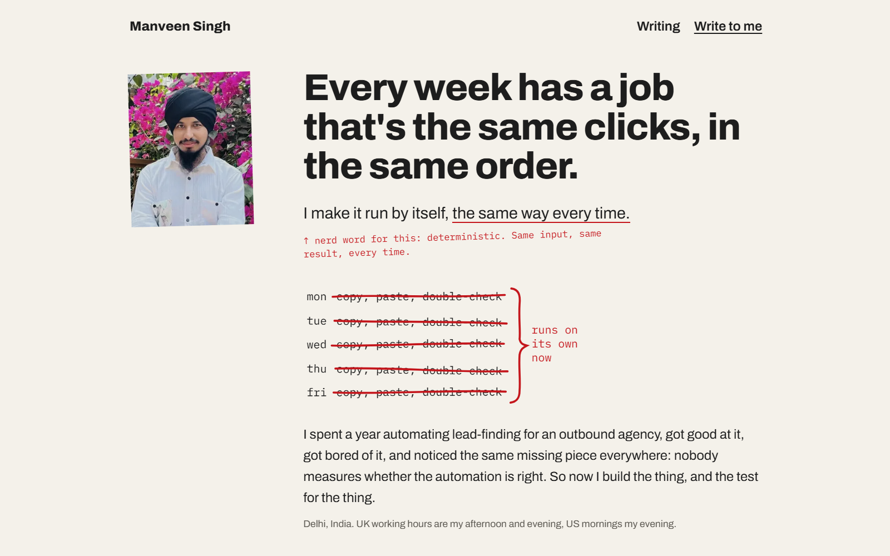

# manveen.me

The website of Manveen Singh, an automation engineer in Delhi, written for business owners. It says what he builds, shows the Tender Radar running every morning with its real numbers, lists his jobs, projects and writing, and ends with his email address.



Next.js 16 (app router), React 19 and TypeScript, plain CSS in `app/globals.css`, tests on Node's own test runner. Live at [manveen.me](https://manveen.me): every push to `master` deploys there through Vercel.

## Run it

```bash
npm install
npm run dev      # http://localhost:3000
npm run build    # production build; npm start serves it
npm test         # build first: the site tests read the pages in .next/
```

`npm test` runs `tests/site.test.mjs`, `tests/runs.test.mjs`, `tests/reveal.test.mjs` and `tests/ai.test.mjs`.

## Working on it

- **Tender Radar numbers.** With `GITHUB_TOKEN` set (fine-grained, Actions:read and Contents:read on Manveen07/new-10x-engineer), the page reads the daily run history from GitHub and caches it for an hour. Without it, the page shows `data/pipeline-snapshot.json` and says the numbers are saved. `npm run refresh-snapshot` rewrites that file (needs the `gh` CLI signed in); rebuild and rerun the tests after.
- **For AI agents.** `/llms.txt` starts with Manveen's own words from `data/llms-intro.ts`. It, `/llms-full.txt`, `/index.md`, `/writing.md`, each post's `.md`, `/resume.md` and `/resume.json` are built from the site's data, and `tests/ai.test.mjs` fails if any of them disagree with the page.
- **Search engines.** Every page names its canonical address and carries schema.org JSON-LD (`lib/md/person.ts`); the sitemap lists the pages and `resume.pdf` only. After a deploy that changes what a page says, `npm run indexnow` tells Bing and the other IndexNow engines to recrawl (the key is `public/<key>.txt`, public by design).
- **Resume.** `data/resume.ts` matches `public/resume.pdf` line for line. After replacing the PDF, run `uv run --with pymupdf python scripts/resume-text.py`, update `data/resume.ts` until the tests pass, then rebuild.

Built by [Manveen Singh](https://manveen.me)
